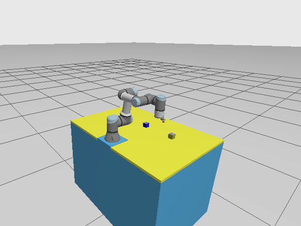
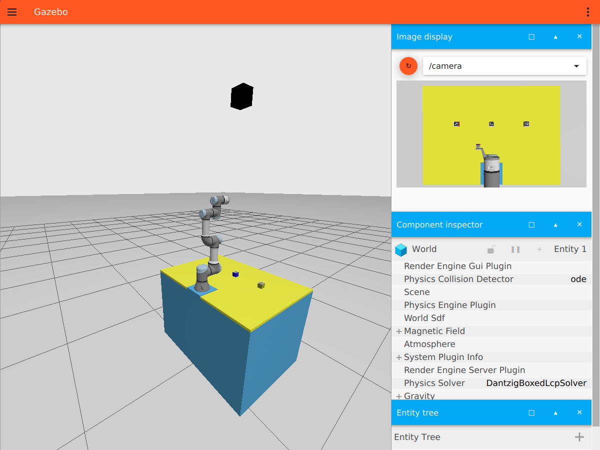
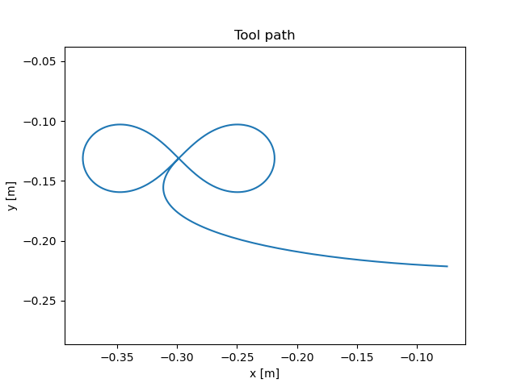

# UR3e Curve Tracer

Give an equation `x(t), y(t)`, and a UR3e draws it in Gazebo. By default it draws an infinity
sign (∞) at a fixed height, with the tool pointing straight down.



This repo is **boilerplate code**. It runs inside the course's existing Docker environment,
so first set that up (Part 1), then add this code (Part 2).

**Contents**
1. [Part 1: The course Docker environment](#part-1-the-course-docker-environment)
2. [Part 2: Run the curve tracer](#part-2-run-the-curve-tracer)
3. [How the code works](#how-the-code-works)
4. [Troubleshooting](#troubleshooting)

---

## Part 1: The course Docker environment

The software (Ubuntu 22.04, ROS 2 Humble, Gazebo, the UR3e driver) comes as a Docker image
maintained by the Maryland Robotics Center. We use it as-is.

| What | Link |
|---|---|
| Docker image and its instructions | [MarylandRoboticsCenter/ENME480_mrc](https://github.com/MarylandRoboticsCenter/ENME480_mrc) |
| Full setup guide (Ubuntu, Mac, Windows) | [ENME480 setup guide](https://enme480.github.io/ubuntu-setup/) |
| Installing Docker on Ubuntu | [docs.docker.com](https://docs.docker.com/engine/install/ubuntu/) |

### 1.1 Get Ubuntu 22.04

| Your computer | What to do |
|---|---|
| **Ubuntu 22.04** | Nothing; continue below. |
| **Mac (Apple Silicon)** | Run Ubuntu 22.04 **ARM64** in a [UTM](https://mac.getutm.app) virtual machine, as the [setup guide](https://enme480.github.io/ubuntu-setup/) explains. Do every step below inside the VM. |
| **Windows** | Use WSL 2 or a virtual machine, as the [setup guide](https://enme480.github.io/ubuntu-setup/) explains. (Its WSL route needs an NVIDIA GPU.) |
| **Lab PC** | Everything is installed already. Skip to [Part 2](#part-2-run-the-curve-tracer). |

### 1.2 Install Docker (once)

```bash
curl -fsSL https://get.docker.com | sudo sh
sudo usermod -aG docker $USER      # lets you use docker without sudo
```

Log out and back in, then check that this works **without** `sudo`:

```bash
docker run --rm hello-world
```

### 1.3 Build the course image (once, about 7 GB)

```bash
git clone https://github.com/MarylandRoboticsCenter/ENME480_mrc.git ~/ENME480_mrc
cd ~/ENME480_mrc/docker
```

**Mac only:** in `humble-enme480_ur3e.Dockerfile`, change the first `FROM` line, as the setup
guide says:

```dockerfile
# before
FROM osrf/ros:humble-desktop AS humble-mod_desktop
# after (Mac only!)
FROM arm64v8/ros:humble AS humble-mod_desktop
```

Then build:

```bash
userid=$(id -u) groupid=$(id -g) docker compose -f humble-enme480_ur3e-compose.yml build
```

On a PC with an NVIDIA GPU, you can use `humble-enme480_ur3e-nvidia-compose.yml` instead of
`humble-enme480_ur3e-compose.yml` here and in every command below. Gazebo is faster that way.

### 1.4 What the image gives you

- **Two workspaces inside the container:**
  - `~/ros_ur_driver`: the UR driver and Gazebo simulation. Don't edit it.
  - `~/enme480_ws`: your workspace.
- **A shared folder:** `~/ENME480_mrc/src` on your computer **is**
  `~/enme480_ws/src` in the container. Code you put there is kept when the container stops.

---

## Part 2: Run the curve tracer

### 2.1 Add this code (once)

Clone this repo into the shared `src` folder, on your computer (not in the container):

```bash
cd ~/ENME480_mrc/src
git clone https://github.com/rishimehta17/Project_2_Example_ur3e_curve_tracer.git ur3e_curve_tracer
```

The folder must be called `ur3e_curve_tracer`, the ROS package name.

### 2.2 Start the container

```bash
xhost +local:docker                 # allow Gazebo windows from the container
cd ~/ENME480_mrc/docker
docker compose -f humble-enme480_ur3e-compose.yml up -d
```

Open a terminal in the container. Repeat this for every new terminal:

```bash
docker exec -it humble-enme480_ur3e-container bash
```

Build, inside the container. Do this once, and again after you change `setup.py`:

```bash
cd ~/enme480_ws && colcon build --symlink-install
```

### 2.3 Run it (3 terminals in the container)

In **each** terminal, first run:

```bash
cd ~/enme480_ws && source install/setup.bash
```

Then:

```bash
# Terminal 1: Gazebo. Wait until the robot appears.
ros2 launch enme480_gazebo enme480_ur3e_cubes.launch.py

# Terminal 2: live plot of the tool path
ros2 run ur3e_curve_tracer live_plot --ros-args -p use_sim_time:=true

# Terminal 3: draw the curve
ros2 run ur3e_curve_tracer trace_curve --ros-args -p use_sim_time:=true
```

**What you should see:**

1. Gazebo opens with the UR3e on the table:

   

2. Terminal 3 prints `Sending trajectory...`. The arm moves to HOME and draws the ∞ in about 25 s:

   

3. Terminal 3 prints `Done, error code 0 (0 = OK)`.

4. The live plot shows the tool path seen from above. On the first run it also shows the arm's
   move from its start pose to HOME (the line from the side):

   

   Close the window (or press Ctrl+C in terminal 2) to save it as `live_plot.png`.

### 2.4 Draw another curve

Keep x and y between −1 and 1. `t` goes from 0 to 2π, and all NumPy functions work
(`sin`, `cos`, `sqrt`, `pi`, …).

```bash
# circle
ros2 run ur3e_curve_tracer trace_curve --ros-args -p use_sim_time:=true -p x:="cos(t)" -p y:="sin(t)"

# figure eight standing up
ros2 run ur3e_curve_tracer trace_curve --ros-args -p use_sim_time:=true -p x:="sin(2*t)/2" -p y:="sin(t)"
```

Restart the live plot before each new curve to get a clean window.

### 2.5 Stop

Close the terminals, then on your computer:

```bash
cd ~/ENME480_mrc/docker && docker compose -f humble-enme480_ur3e-compose.yml down
```

---

## How the code works

```
ur3e_curve_tracer/
├── ur3e_curve_tracer/
│   ├── trace_curve.py   # equation → points → IK → one trajectory → robot
│   └── live_plot.py     # live plot of the tool position
├── package.xml          # ROS package info
└── setup.py             # installs the commands trace_curve and live_plot
```

**`trace_curve.py`**
1. Reads the equation (parameters `x`, `y`) and evaluates it at 200 values of `t`.
2. Each point becomes a goal pose: the tool pose at HOME, shifted in x and y by 8 cm × (x, y).
   So the height and the tool orientation never change.
3. Inverse kinematics (damped least squares, using the UR3e DH model) turns each goal pose into
   6 joint angles. Each solve starts from the previous answer, so the motion is smooth.
4. All points go to the robot's trajectory controller as **one** trajectory (one point every
   0.1 s). The controller then moves smoothly through them without stopping.

**`live_plot.py`**
- 20 times per second, it asks TF where the tool (`tool0`) is in the frame `base`.
- It draws that x–y path, and redraws 10 times per second.
- It only watches the robot, so it shows what the robot really did.

The code is commented line by line. Start reading at `main()` in `trace_curve.py`.

---

## Troubleshooting

| Problem | Fix |
|---|---|
| `cannot open display` / no Gazebo window | Run `xhost +local:docker` on your computer, then restart the container. |
| `Package 'ur3e_curve_tracer' not found` | `cd ~/enme480_ws && colcon build --symlink-install && source install/setup.bash` |
| `trace_curve` waits and does nothing | Gazebo isn't fully started yet. Wait, or check terminal 1 for errors. |
| `docker: permission denied` | You skipped logging out after `usermod`. Log out and back in. |
| The plot timing looks wrong | Add `--ros-args -p use_sim_time:=true`. |
