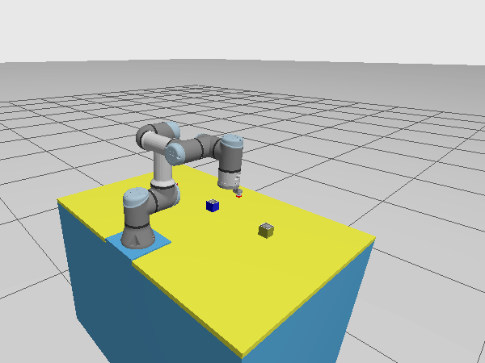
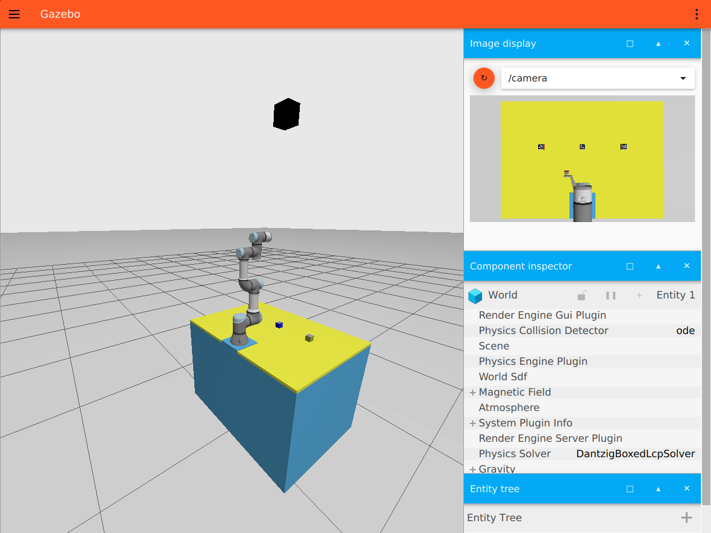
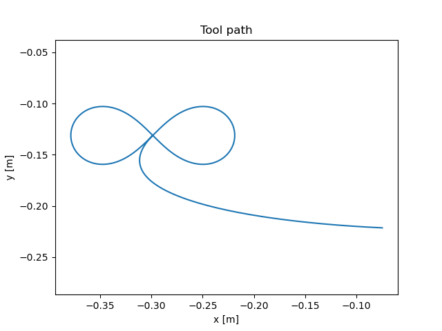

# ENPM662 UR3e: Docker, ROS 2, Gazebo and the curve tracer

This repository is the ENPM662 environment for the UR3e robot arm at the University of Maryland,
College Park. It has three parts:

- **A Docker image** (Ubuntu 22.04, ROS 2 Humble, Gazebo, the UR driver) so everyone runs the same software.
- **The course ROS 2 packages** (robot description, Gazebo worlds, helper nodes).
- **`ur3e_curve_tracer`**, our starter package: give an equation `x(t), y(t)`, and the UR3e draws
  it. It runs the same way **in simulation** and **on the real robot**.



The Docker setup and the `ur3e_mrc*` / `mrc_gazebo_plugins` packages are based on work by the
[Maryland Robotics Center](https://github.com/MarylandRoboticsCenter). Everything that carried a
course name is named `enpm662`.

**Contents**
1. [Overview](#overview)
2. [Part 1: Set up the environment](#part-1-set-up-the-environment)
3. [Part 2: Simulation (Gazebo)](#part-2-simulation-gazebo)
4. [Part 3: The real UR3e (lab)](#part-3-the-real-ur3e-lab)
5. [How the curve tracer works](#how-the-curve-tracer-works)
6. [Troubleshooting](#troubleshooting)

---

## Overview

| Folder | What it is |
|---|---|
| `docker/` | Dockerfile and Docker Compose files (`humble-enpm662_ur3e*`). |
| `config/` | Settings shared with the container: `ur3e_setup.bash` (ROS domain, your IP, robot IP). |
| `src/enpm662_description` | UR3e robot model (URDF/xacro), table and tool meshes. |
| `src/enpm662_gazebo` | Gazebo worlds and launch files: `enpm662_ur3e_cubes.launch.py`, `enpm662_ur3e_empty.launch.py`. |
| `src/ur3e_mrc`, `src/ur3e_mrc_sim`, `src/ur3e_mrc_msgs` | Helper nodes and messages (`/ur3e/command`) for the real robot and for simulation. |
| `src/mrc_gazebo_plugins` | Gazebo vacuum gripper plugin. |
| `src/ur3e_curve_tracer` | **Our package:** `trace_curve` and `live_plot`. |

The container has two workspaces:

- `~/ros_ur_driver`: the UR driver and Gazebo simulation packages. Don't edit it: changes are lost
  when the container stops. To change it, edit the Dockerfile and rebuild the image.
- `~/enpm662_ws`: your workspace. Two folders from your computer are shared into it, so edits
  persist after the container stops:
  - `src/` in this repository is `~/enpm662_ws/src`
  - `config/` in this repository is `~/enpm662_ws/config`

---

## Part 1: Set up the environment

| Your computer | What to do |
|---|---|
| **Ubuntu 22.04** | Continue below. |
| **Mac (Apple Silicon)** | Run Ubuntu 22.04 **ARM64** in a [UTM](https://mac.getutm.app) virtual machine. Do every step below inside the VM. |
| **Windows** | Use WSL 2 or a virtual machine. (The WSL route needs an NVIDIA GPU.) |
| **Lab PC** | Docker and the image are installed already. Skip to Part 2 (simulation) or Part 3 (robot). |

### 1.1 Install Docker (once)

```bash
curl -fsSL https://get.docker.com | sudo sh
sudo usermod -aG docker $USER      # lets you use docker without sudo
```

Log out and back in, then check that this works **without** `sudo`:

```bash
docker run --rm hello-world
```

### 1.2 Get this repository (once)

```bash
git clone -b enpm662 https://github.com/rishimehta17/Project_2_Example_ur3e_curve_tracer.git ~/ENPM662_mrc
cd ~/ENPM662_mrc/docker
```

The `-b enpm662` part is required: this repository's default branch is something else. On lab PCs the
repository may already be in `~/rosPackages/ENPM662_mrc`. If so, use that path instead of
`~/ENPM662_mrc` everywhere below.

### 1.3 Build the image (once, about 7 GB)

**Mac only:** in `humble-enpm662_ur3e.Dockerfile`, change the first `FROM` line:

```dockerfile
# before
FROM osrf/ros:humble-desktop AS humble-mod_desktop
# after (Mac only!)
FROM arm64v8/ros:humble AS humble-mod_desktop
```

Then build. Do this again every time the Dockerfile changes:

```bash
cd ~/ENPM662_mrc/docker
userid=$(id -u) groupid=$(id -g) docker compose -f humble-enpm662_ur3e-compose.yml build
```

On a PC with an NVIDIA GPU, use `humble-enpm662_ur3e-nvidia-compose.yml` instead of
`humble-enpm662_ur3e-compose.yml` here and in every command below. Gazebo is faster that way.

---

## Part 2: Simulation (Gazebo)

### 2.1 Start the container

```bash
xhost +local:docker                 # allow Gazebo windows from the container
export XAUTHORITY=${XAUTHORITY:-$HOME/.Xauthority}   # Docker Compose needs this variable set
touch "$XAUTHORITY"                                  # ...and the file to exist
cd ~/ENPM662_mrc/docker
docker compose -f humble-enpm662_ur3e-compose.yml up -d
```

Open a terminal in the container. Repeat this for every new terminal:

```bash
docker exec -it humble-enpm662_ur3e-container bash
```

Build, inside the container. Do this once, and again after you change a package's `setup.py`,
`CMakeLists.txt` or `package.xml`:

```bash
cd ~/enpm662_ws && colcon build --symlink-install
```

Tip: `tmux` is installed. `tmux` starts a session, `Ctrl+A b` splits horizontally, `Ctrl+A v`
splits vertically.

### 2.2 Run the curve tracer (3 terminals in the container)

In **each** terminal, first run:

```bash
cd ~/enpm662_ws && source install/setup.bash
```

Then:

```bash
# Terminal 1: Gazebo. Wait until the robot appears.
ros2 launch enpm662_gazebo enpm662_ur3e_cubes.launch.py

# Terminal 2: live plot of the tool path
ros2 run ur3e_curve_tracer live_plot --ros-args -p use_sim_time:=true

# Terminal 3: draw the curve
ros2 run ur3e_curve_tracer trace_curve --ros-args -p use_sim_time:=true
```

**What you should see:**

1. Gazebo opens with the UR3e on the table:

   

2. Terminal 3 prints `Sending trajectory...`. The arm moves to HOME and draws the ∞ in about 25 s:

   

3. Terminal 3 prints `Done, error code 0 (0 = OK)`.

4. The live plot shows the tool path seen from above. On the first run it also shows the arm's
   move from its start pose to HOME:

   

   Close the window (or press Ctrl+C in terminal 2) to save it as `live_plot.png`.

### 2.3 Draw another curve

Keep x and y between −1 and 1. `t` goes from 0 to 2π, and all NumPy functions work
(`sin`, `cos`, `sqrt`, `pi`, …).

```bash
# circle
ros2 run ur3e_curve_tracer trace_curve --ros-args -p use_sim_time:=true -p x:="cos(t)" -p y:="sin(t)"

# figure eight standing up
ros2 run ur3e_curve_tracer trace_curve --ros-args -p use_sim_time:=true -p x:="sin(2*t)/2" -p y:="sin(t)"
```

Restart the live plot before each new curve to get a clean window.

### 2.4 Other simulation tools

- `ros2 launch enpm662_gazebo enpm662_ur3e_empty.launch.py` starts Gazebo with an empty world
  (no table objects).
- To move the arm by joint angles instead, start the simulation, then in another terminal:

  ```bash
  ros2 launch ur3e_mrc_sim ur3e_enpm662.launch.py
  ros2 topic pub --once /ur3e/command ur3e_mrc_msgs/msg/CommandUR3e "destination: [0, -1.57, -1.57, 0, 0, 0]
  v: 1.0
  a: 1.0
  io_0: false"
  ```

### 2.5 Stop

Close the terminals, then on your computer:

```bash
cd ~/ENPM662_mrc/docker && docker compose -f humble-enpm662_ur3e-compose.yml down
```

---

## Part 3: The real UR3e (lab)

**Run it in simulation first.** Only run on the real arm after your simulation works. The same
`trace_curve` code is used; the only difference is that you do **not** pass `use_sim_time:=true`.

### Safety checklist

- Stay at the robot with a hand near the **emergency stop**. Another person should be nearby.
- Lower the **speed slider** on the teaching pendant (for example to 20–30%) for the first run. The
  trajectory is scaled by it.
- The curve is drawn within about ±10 cm of HOME, tool pointing down. Clear that area: no cables,
  tools or people within reach of the arm.
- HOME is where the trajectory starts. If the arm is far from HOME, it first moves there in 4 s.
  Move the arm close to HOME **before** you run (step 1).
- Stop immediately (e-stop) if the motion looks wrong. Don't try to correct it by running more commands.
- Never stand inside the arm's reach while it is powered, and never bypass an interlock or remove a guard.
- Free drive (the black button on the back of the pendant): move the arm **slowly**. Moving it too
  fast can lock you out.

### 3.1 Before you start

1. **Power on the robot.** Press the power button on the teaching pendant. Then press the **arm**
   button: the first press powers the robot on, and the second press releases the brakes (you
   hear a series of loud clicks).
2. **Put the arm near HOME.** HOME in joint angles is `[0°, −90°, 90°, −90°, −90°, 0°]` (the code uses
   `[0, -1.57, 1.57, -1.57, -1.57, 0]` rad). On the pendant, use the **Move** tab and the joint
   controls to get close. Do this **before** starting the External Control program: once the
   computer is in control, the pendant's move controls must not be used.
3. **Check the network settings** in `config/ur3e_setup.bash`: `UR_IP` (the robot) and `YOUR_IP`
   (your PC). They must match the lab setup. Every terminal you open in the container reads this
   file.
4. **Start the container and build**, as in [2.1](#21-start-the-container).

### 3.2 Run (3 terminals in the container)

In **each** terminal, first run:

```bash
cd ~/enpm662_ws && source install/setup.bash
```

1. **Start the UR driver** (terminal 1):

   ```bash
   ros2 launch ur_robot_driver ur_control.launch.py ur_type:=ur3e robot_ip:=${UR_IP} \
     kinematics_params_file:=${HOME}/enpm662_ws/config/ur3e_mrc.yaml
   ```

   `ur3e_mrc.yaml` is the lab's calibration file for the arm. If it is not in `config/`, ask the lab
   manager for it. Without it, drop the `kinematics_params_file` argument.

2. **On the teaching pendant**, start the program that allows ROS 2 control:
   `Programs → URCaps → External Control → Control_by_MRC_ur3e_pc`, and press play.
   Terminal 1 should print `Robot connected to reverse interface. Ready to receive control commands.`
   If it doesn't, don't continue: check the IP settings and that the program is running.

   **After this, don't use the pendant's touchpad controls** (Move tab, free drive). If you do,
   stop the driver and start again from step 1.

3. **Check that the trajectory controller is active** (terminal 2):

   ```bash
   ros2 control list_controllers
   ```

   `scaled_joint_trajectory_controller` must be `active`. This is the controller `trace_curve`
   sends the trajectory to, in simulation and on the robot.

4. **Watch the tool path** (terminal 2, after the check) and **draw** (terminal 3):

   ```bash
   # Terminal 2
   ros2 run ur3e_curve_tracer live_plot

   # Terminal 3
   ros2 run ur3e_curve_tracer trace_curve
   ```

   Draw another curve the same way as in simulation, for example
   `ros2 run ur3e_curve_tracer trace_curve --ros-args -p x:="cos(t)" -p y:="sin(t)"`.

5. **Shut down:**
   1. Ctrl+C in each terminal, and stop the program on the pendant.
   2. On the pendant, open the **Move** screen and tap **Home** (bottom middle). Hold **Move to
      new position** until the robot is fully in position and the screen says the move is done.
      This is the pendant's own Home pose, not our HOME: move to our HOME again before the next run.
   3. Power the robot down, then on your computer
      `docker compose -f humble-enpm662_ur3e-compose.yml down`. Close all terminals before you leave.

**If you press the emergency stop while the computer is in control**, the driver connection breaks.
Close the driver, release the e-stop (twist the knob until it pops up), release the brakes with the
arm button, and repeat from step 1. Report any damage to a TA or the lab manager right away.

### 3.3 Move the arm by joint angles (optional)

The lab helper package `ur3e_mrc` publishes joint commands on `/ur3e/command`. Start it in another
terminal, with the driver running and External Control active:

```bash
ros2 launch ur3e_mrc ur3e_enpm662.launch
ros2 topic pub --once /ur3e/command ur3e_mrc_msgs/msg/CommandUR3e "destination: [0, -1.57, -1.57, 0, 0, 0]
v: 1.0
a: 1.0
io_0: false"
```

Test angles (rad):

```
[0, -0.758, 0, 0.758,-1.571, 1.048]
[-0.524,-1.048, 1.396,-0.175,-1.571,-0.524]
[0.524,-1.222, 1.396,-0.175, -1.571,0.175]
[-0.524,-1.048, 1.048,-0.175,-1.571,-0.524]
```

Laser pointer: `ros2 topic pub --once /ur3e/laser_point std_msgs/msg/Bool "data: true"`

---

## How the curve tracer works

```
src/ur3e_curve_tracer/
├── ur3e_curve_tracer/
│   ├── trace_curve.py   # equation → points → IK → one trajectory → robot
│   └── live_plot.py     # live plot of the tool position
├── package.xml          # ROS package info
└── setup.py             # installs the commands trace_curve and live_plot
```

**`trace_curve.py`**
1. Reads the equation (parameters `x`, `y`) and evaluates it at 200 values of `t`.
2. Each point becomes a goal pose: the tool pose at HOME, shifted in x and y by 8 cm × (x, y).
   So the height and the tool orientation never change.
3. Inverse kinematics (damped least squares, using the UR3e DH model) turns each goal pose into
   6 joint angles. Each solve starts from the previous answer, so the motion is smooth.
4. All points go to the robot's trajectory controller as **one** trajectory (one point every
   0.1 s). The controller then moves smoothly through them without stopping.

**`live_plot.py`**
- 20 times per second, it asks TF where the tool (`tool0`) is in the frame `base`.
- It draws that x–y path, and redraws 10 times per second.
- It only watches the robot, so it shows what the robot really did.

The code is commented line by line. Start reading at `main()` in `trace_curve.py`.

---

## Troubleshooting

| Problem | Fix |
|---|---|
| `cannot open display` / no Gazebo window | Run `xhost +local:docker` on your computer, then restart the container. |
| `Package 'ur3e_curve_tracer' not found` | `cd ~/enpm662_ws && colcon build --symlink-install && source install/setup.bash` |
| `trace_curve` waits and does nothing | Gazebo (or the robot driver) isn't ready yet. Wait, or check terminal 1 for errors. On the robot: is External Control running on the pendant? |
| `invalid spec: :/home/enpm662_docker/.Xauthority: empty section between colons` | The `XAUTHORITY` variable isn't set in your shell. Run `export XAUTHORITY=${XAUTHORITY:-$HOME/.Xauthority}; touch "$XAUTHORITY"` and try again. |
| `docker: permission denied` | You skipped logging out after `usermod`. Log out and back in. |
| The plot timing looks wrong | In simulation add `--ros-args -p use_sim_time:=true`; on the robot don't. |
| Robot does not move, pendant says protective stop | Clear the cause, release the protective stop on the pendant, restart External Control. |
| Can't reach the robot | Check `UR_IP` / `YOUR_IP` in `config/ur3e_setup.bash` and that your PC is on the robot's network. |

---

## Used resources

1. [Maryland Robotics Center](https://github.com/MarylandRoboticsCenter): the original Docker setup and MRC packages
2. [docker-for-robotics](https://github.com/2b-t/docker-for-robotics)
3. [Universal Robots ROS 2 driver](https://github.com/UniversalRobots/Universal_Robots_ROS2_Driver)
4. [UR ROS 2 driver documentation](https://docs.universal-robots.com/Universal_Robots_ROS2_Documentation/doc/ur_robot_driver/ur_robot_driver/doc/usage/toc.html)
